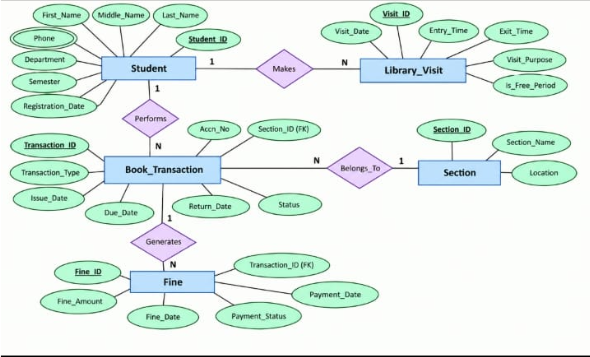

# Library Entry Register System

A MySQL database for recording library entries, book issues and returns, and fines, with queries that support resource planning and utilization.

See the full [Problem Statement](Problem-Statement.md).

## ER Diagram



### Relationships

| Relationship | Entities | Cardinality |
|---|---|---|
| Makes | Student – Library_Visit | 1 : N |
| Performs | Student – Book_Transaction | 1 : N |
| Belongs_To | Book_Transaction – Section | N : 1 |
| Generates | Book_Transaction – Fine | 1 : N |

`Phone` is a multivalued attribute of Student, so it is stored in a separate `Student_Phone` table.

## Project Files

| File | Contents |
|---|---|
| [01_schema.sql](sql/01_schema.sql) | Database and 6 tables with primary keys, foreign keys and CHECK constraints |
| [02_data.sql](sql/02_data.sql) | Sample data (includes one suspicious duplicate student for testing) |
| [03_queries.sql](sql/03_queries.sql) | 9 resource planning and utilization queries |
| [04_views.sql](sql/04_views.sql) | Views for students, librarians and administrators |
| [05_triggers_procedures.sql](sql/05_triggers_procedures.sql) | 3 functions, 5 triggers, 7 stored procedures |

## Queries

| No. | Query | Tables Used |
|---|---|---|
| Q1 | Duplicate / suspicious student identities (same name, shared phone) | Student, Student_Phone |
| Q2 | Peak library hours | Library_Visit |
| Q3 | Students using the library in free periods | Library_Visit, Student |
| Q4 | Most frequent visitors | Library_Visit, Student |
| Q5 | Purpose of visits | Library_Visit |
| Q6 | Most demanded book in each section | Book_Transaction, Section |
| Q7 | Students who spend maximum time in the library | Library_Visit, Student |
| Q8 | Frequent defaulters on book return | Book_Transaction, Student |
| Q9 | Total fine collected per month | Fine |

## Views

| User | View | Shows |
|---|---|---|
| Student | `vw_student_books` | Own issued books and status |
| Student | `vw_student_fines` | Own fines |
| Student | `vw_student_visits` | Own visits and time spent |
| Librarian | `vw_librarian_books_out` | Books not yet returned, days overdue |
| Librarian | `vw_librarian_unpaid_fines` | Unpaid fines with student email |
| Librarian | `vw_librarian_visit_register` | Daily entry register |
| Admin | `vw_admin_department_usage` | Department-wise visits and time |
| Admin | `vw_admin_section_circulation` | Section-wise issues |
| Admin | `vw_admin_fine_summary` | Paid vs unpaid fine totals |

## Triggers, Procedures and Functions

| Type | Name | Purpose |
|---|---|---|
| Function | `fn_calculate_fine` | Rs 10 per day after due date |
| Function | `fn_is_copy_available` | Checks whether a book copy is free to issue |
| Function | `fn_total_library_minutes` | Total time a student spent in the library |
| Trigger | `trg_before_book_issue` | Blocks issuing an already-issued copy, sets status |
| Trigger | `trg_before_book_return` | Sets status to Returned when return date is entered |
| Trigger | `trg_after_book_return` | Creates a fine automatically on late return |
| Trigger | `trg_before_visit_insert` | Blocks overlapping visits of the same student |
| Trigger | `trg_before_fine_payment` | Fills payment date when a fine is paid |
| Procedure | `sp_issue_book` | Issues a book for 7 days |
| Procedure | `sp_return_book` | Returns a book |
| Procedure | `sp_record_entry` / `sp_record_exit` | Records library entry and exit |
| Procedure | `sp_mark_overdue` | Marks unreturned books past due date as Overdue |
| Procedure | `sp_pay_fine` | Marks a fine as paid |
| Procedure | `sp_student_report` | Summary of one student |

## How to Run

Requires MySQL 8.0.16 or later (or MariaDB 10.4+). Run the files in order in MySQL Workbench or the MySQL command line:

```
SOURCE sql/01_schema.sql;
SOURCE sql/02_data.sql;
SOURCE sql/03_queries.sql;
SOURCE sql/04_views.sql;
SOURCE sql/05_triggers_procedures.sql;
```

Test commands for the procedures and triggers are at the end of `05_triggers_procedures.sql`.
